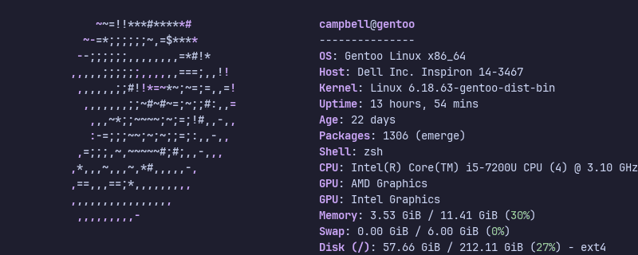

# nexus

A small, fast spinning 3D terminal fetch tool. `nexus` lifts an ASCII/Unicode
logo into a height map, extrudes it into a point cloud, and renders it as a
rotating relief with Blinn-Phong shading, with system information shown beside
it.

It is a from-scratch, modular C program inspired by the single-file
[`fetch`](https://github.com/areofyl/fetch) tool. Everything is kept minimal:
info comes straight from `/proc`, `/sys` and `/etc`, so startup stays quick.
The only build dependency is `libm`. If `fastfetch` is installed at runtime its
logo library is used for authentic distro logos; otherwise a small embedded set
is drawn. Linux is the primary target, with best-effort macOS support behind
`#ifdef __APPLE__`.



## Quick start

```
make
./nexus
```

Press any key to stop. `make install` puts it in `/usr/local/bin` (or use
`PREFIX=~/.local make install`).

## Documentation

| Guide | Contents |
| ----- | -------- |
| [Building and installing](doc/building.md) | `make`, dependencies, install, the Nix flake |
| [Dependencies](doc/dependencies.md) | what to install to build and run |
| [Building against musl](doc/musl.md) | native musl, static builds, cross-compiling |
| [Command-line options](doc/options.md) | every flag |
| [Configuration](doc/configuration.md) | `nexus.json`, keys, profiles, custom lines |
| [Logos](doc/logos.md) | logo selection, file format, colours |
| [Shading](doc/shading.md) | the shading ramp |
| [Info fields](doc/fields.md) | fields, `nix`, title/separator, palette |

## Layout

```
nexus/
  Makefile
  demo.gif           animated demo for the README
  doc/
    building.md       build, install and the Nix flake
    dependencies.md   packages needed to build and run
    musl.md           building against musl and cross-compiling
    options.md        command-line options
    configuration.md  config file, keys and profiles
    logos.md          logo selection, file format and colours
    shading.md        the shading ramp
    fields.md         info fields, title/separator and palette
  src/
    nexus.h    shared declarations
    util.c     text / terminal / parsing helpers
    config.c   config file reader and first-run template
    logo.c     logo loading, decoding and distro tinting
    distros.c  embedded plain-text distro logos (generated)
    info.c     native system-information gathers
    render.c   height map, projection, shading and the animation loop
    main.c     CLI parsing and orchestration
```

## Changelog

See [CHANGELOG.md](CHANGELOG.md).

## License

MIT. See [LICENSE](LICENSE).
